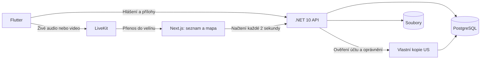

# Krizovka – jednoduchý technický záměr

**Verze:** 0.5 – vlastní kopie uživatelské služby a lokální Kubernetes  
**Datum:** 17. 10. 2026  
**Souvisí s:** [produktovým záměrem](produktovy-zamer.md) a [inventářem existujících aplikací](docs/inventar-existujicich-aplikaci.md)

Hlavní úkol je jediný: **rychle a tiše poslat organizaci „potřebuji pomoc, něco se tady děje“ spolu s kontakty a dostupnou polohou.** Uživatel může poslat text nebo hlasovku a spustit přímý živý audio či video přenos do velínu. Druhá záložka obsahuje vlastní metodiky organizace jako manuál, jak se zachovat. Nastavení je třetí částí pro osobní údaje uložené v zařízení. Mapa je pouze v administraci. Produkt od první verze obsluhuje více oddělených organizací v jedné aplikaci.

Tato verze nahrazuje předchozí návrh. Zjednodušení se týká architektury a ovládání; text, hlasovka a živé audio/video jsou součástí první verze. Inventář zdrojů není seznam dalších povinných funkcí.

## 1. Technický základ

| Část | Technologie | Z čeho vyjdeme |
| --- | --- | --- |
| Uživatelská aplikace pro web, iOS a Android | Flutter, Riverpod, GoRouter, Dio. | `OICT_Aplikace/zmente-to-flutter`: přihlášení, síťová vrstva, fotografie a poloha. |
| Backend | Jeden ASP.NET Core backend v .NET 10, EF Core a PostgreSQL. | Použitelné části hlášení z `city-plus/src/Services/IS` a ukládání souborů z DS. |
| Uživatelé a oprávnění | Vlastní kopie City+ US v .NET 10, vlastní databáze. | `city-plus/src/Services/US` a potřebné sdílené knihovny; samostatné nasazení `krizovka-users`. |
| Administrace a dohled | Next.js, existující komponenty a MapLibre. | `city-plus/src/Apps/Frontend`: seznam, detail, přihlášení a mapová integrace. |
| Živý audio/video přenos | Hotová WebRTC služba LiveKit a její klientská SDK. | Nová integrace existujícího řešení; v prohledaných lokálních manifestech nebyl streamovací základ nalezen. |

Přebíráme potřebný základ a upravujeme ho pro Krizovku. Zdrojové projekty zůstanou beze změny. Nová aplikace musí fungovat samostatně, bez ostatních služeb Města+ nebo přihlášení přes Lítačku. Konkrétní nalezené soubory a jejich omezení jsou v inventáři.

## 2. Co udělá uživatel

Aplikace se otevře na záložce **Hlášení** s velkým tlačítkem **POTŘEBUJI POMOC**. Hlavní uživatelské části jsou:

| Část | Účel |
| --- | --- |
| **Hlášení** | Text, hlasovka, živé audio/video a rychlá pomoc. |
| **Metodiky** | Manuál krizových situací platný pro aktivní organizaci. |
| **Nastavení** | Osobní údaje, aktivní organizace a příprava oprávnění telefonu; dostupné přes ikonu nastavení. |

Na záložce hlášení jsou čtyři srozumitelné možnosti:

| Možnost | Co provede |
| --- | --- |
| **Text** | Napsat a odeslat krátkou zprávu. |
| **Hlasovka** | Nahrát hlasovou zprávu a po zastavení ji odeslat jako uloženou přílohu. |
| **Živě audio** | Okamžitě vysílat mikrofon do velínu, bez kamery. |
| **Živě video** | Okamžitě vysílat kameru a mikrofon do velínu. |

1. Uživatel stiskne tlačítko. Aplikace okamžitě odešle základní hlášení.
2. Automaticky se přiloží jméno, příjmení, osobní číslo, telefon a e-mail vyplněné v Nastavení a uložené v zařízení. Backend zvlášť ověří účet a příslušnost k organizaci.
3. Připojí se dostupná poloha. Čerstvě zjištěná poloha se případně doplní hned poté.
4. Administrace během nejbližšího obnovení ukáže nové hlášení, kontakty a bod na mapě.

Text, například „střílí se tady“, lze poslat samostatně nebo doplnit ke hlášení. Spuštění hlasovky či živého přenosu současně založí základní hlášení; organizace nemusí čekat na dokončení nahrávky nebo navázání streamu. Fotografie a uložený videoklip zůstávají dostupnými přílohami. Kategorie, souhlasy, výběr adresáta ani další potvrzovací obrazovka nejsou součástí krizového odeslání.

Přihlášení, aktivní organizace, kontakty a oprávnění telefonu se připraví předem. Při incidentu uživatel nic z toho znovu nevyplňuje.

### Nastavení a uložení osobních údajů

Uživatel zde vyplní a později upraví **jméno, příjmení, osobní číslo, telefon a e-mail**. Může zkontrolovat aktivní organizaci, připravenost kamery/mikrofonu/polohy a použít **Vymazat moje údaje z tohoto zařízení**.

- **iOS a Android:** malý profil v chráněném úložišti telefonu, s využitím stávajícího `flutter_secure_storage`.
- **Web:** trvalá profilová cookie nastavená backendem, šifrovaná a chráněná proti změně pomocí ASP.NET Core Data Protection. Použije `Secure`, `HttpOnly`, `SameSite=Lax` a vazbu na účet a organizaci. Formulář ji načte a uloží přes API; JavaScript nemusí přímo číst cookie. [Data Protection](https://learn.microsoft.com/en-us/aspnet/core/security/data-protection/consumer-apis/overview?view=aspnetcore-10.0), [atributy cookies](https://developer.mozilla.org/en-US/docs/Web/HTTP/Reference/Headers/Set-Cookie).

Webový profil projde přes API při uložení cookie, ale nevzniká tím další centrální databázový profil kontaktů. U hlášení už server uloží jejich kopii. Cookie obsahuje jen malé textové údaje, má omezenou platnost a velikost; fotografie, audio ani video do ní nepatří. Data Protection klíče musí přetrvat restart backendu. Odstranění či expirace cookie znamená nutnost profil znovu vyplnit.

Profil je místní pro konkrétní zařízení nebo prohlížeč; automatická synchronizace zařízení se nezavádí. Patří ke konkrétnímu účtu a organizačnímu kontextu, aby se například osobní číslo nepoužilo pro jinou organizaci. Při změně účtu nebo organizace se zkontroluje odpovídající profil; cizí uložené údaje se automaticky nepřevezmou. Neúplný profil se označí předem v Nastavení. Samotné nouzové hlášení může odejít s dostupnými údaji a příjemce uvidí, co chybí.

## 3. Nejjednodušší tok dat

Backend má běžné controllery, služby a databázové entity v jednom projektu. Metodiky a hlášení obsluhuje hlavní API. Účty a oprávnění zajišťuje vlastní kopie uživatelské služby z City+, kterou hlavní API volá přes interní HTTP s vlastním API klíčem. Soubory uloží do neveřejného adresáře na trvalém disku; databáze obsahuje jejich metadata.

Více organizací používá stejné nasazení a databázi. Oddělení zajistí `OrganizationId` a kontrola členství u každé operace, nikoliv zvláštní backend pro každého zákazníka. Společná knihovna šablon je výslovně sdílený obsah; publikované metodiky a hlášení už patří jednotlivým organizacím.

Živé médium prochází přes LiveKit přímo mezi klienty a mediální službou. .NET zajišťuje oprávnění a připojení streamu k hlášení; samotné video ani zvuk se nepřeposílají přes běžné REST requesty nebo dvousekundové načítání seznamu.

Pro začátek postačí struktura `apps/client` pro Flutter, `apps/admin` pro Next.js a `backend/Krizovka.Api` pro backend. PostgreSQL a aplikace poběží na dostupném lokálním Minikube serveru `kuba@192.168.1.38`, společně v novém namespace `krizovka`. Uživatelská služba má vlastní kopii pod `backend/recycled`, převzaté testy jsou pod `backend/Tests`. PostgreSQL má jeden trvalý disk a dvě oddělené databáze s vlastními databázovými rolemi: `krizovka` a `krizovka_users`. Existující kód rozdělíme jen tolik, kolik už vyžaduje jeho praktické převzetí.

## 4. Odeslání a poloha

Základní request obsahuje klientské ID hlášení, aktivní organizační kontext, čas, volitelný text a případnou polohu. Mobil automaticky přiloží kopii lokálního profilu. Na webu backend vezme profil z chráněné cookie. Příslušnost k organizaci vždy ověří podle přihlášení; organizační ID uvedené v profilu nebo requestu samo přístup nezakládá.

Kontakty jsou **údaje vyplněné uživatelem**. U hlášení se uloží jejich podoba při odeslání, zdroj a odkaz na přihlášený účet. Přihlášení ani šifrovaná cookie samy neověřují pravdivost osobního čísla nebo telefonu. Pozdější změna Nastavení nezmění kontakty již doručeného hlášení.

Zjištění polohy začne jednorázově při otevření záložky hlášení, pokud už je udělené oprávnění. Při odeslání se použije právě dostupná poloha včetně času měření a přesnosti. Pokud není, základní zpráva přesto ihned odejde a aplikace se ji pokusí doplnit samostatným požadavkem po získání polohy. Zjišťování GPS nesmí zdržet přivolání pomoci.

Administrace rozliší aktuální měření, starší měření a chybějící polohu. GPS neurčuje spolehlivě místnost nebo podlaží. Volitelný text „budova B, učebna 203“ se proto zobrazí vedle mapy. Poloha se pořizuje pro hlášení; průběžné sledování osoby se nezavádí.

Server vrátí úspěch až po uložení do databáze. Klient ukazuje **Odesílám → Doručeno**, případně **Nepodařilo se odeslat – Zkusit znovu**. Stav **Převzato** zobrazí teprve podle potvrzení operátora. Po nejistém výsledku nebo opakování použije stejné klientské ID; unikátní klíč organizace, účtu a klientského ID zabrání duplicitě. Přepnutí organizace nepřesměruje rozepsané nebo opakovaně odesílané hlášení jinému příjemci.

Při výpadku spojení aplikace zachová údaje pro další pokus v právě otevřené relaci a neoznačí hlášení za doručené. Automatické odesílání po zavření aplikace ani trvalá offline fronta nejsou součástí první verze. Pokud relace vypršela, aplikace to ukáže a nabídne dostupné tísňové a místní kontakty; nebude předstírat úspěšné hlášení.

## 5. Hlasovky, přílohy a živý přenos

### Uložené zprávy a přílohy

Hlasovka, fotografie a uložený videoklip použijí existující Flutter pluginy a běžný `multipart/form-data` upload jednoho souboru. Hlasovka se odešle po zastavení nahrávání a zůstane u hlášení pro pozdější přehrání. Při chybě uploadu zůstává základní hlášení doručené a přílohu lze zkusit odeslat znovu, dokud je dostupná v klientovi.

Výchozí limity pro ověření: fotografie 10 MB, audio a video nejvýše 60 sekund a 50 MB na soubor. Použijeme formáty, které skutečně zvládnou zaznamenat klienti a přehrát podporovaný prohlížeč administrace. V první verzi nebude samostatná služba na převody médií.

### Živé audio a video do velínu

Navrženým základem je **LiveKit**: Flutter klient použije `livekit_client`, Next.js dohled `livekit-client` a hotové React komponenty. SDK poskytují připojení a publikování či příjem médií; Krizovka doplní své ovládání a oprávnění. Nebudeme vyvíjet vlastní WebRTC server. [Flutter SDK](https://docs.livekit.io/transport/sdk-platforms/flutter/), [React komponenty](https://github.com/livekit/components-js).

Průběh je krátký:

1. Volba **Živě audio** nebo **Živě video** okamžitě odešle základní hlášení.
2. .NET ověří oznamovatele, založí streamovou relaci k tomuto hlášení a vydá oprávnění pro konkrétní místnost.
3. Flutter se připojí a začne vysílat mikrofon, případně kameru. Nečeká na ruční přijetí hovoru operátorem.
4. Velín u hlášení vidí nabídku živého přenosu. Operátor stiskne **Otevřít přenos / Poslouchat** a připojí se k němu.
5. Uživatel může přenos kdykoliv zastavit. Ukončení zastaví kameru a mikrofon, odpojí relaci a ponechá uložené hlášení.

Přenos je výchozím návrhem **jednosměrný do velínu**. Telefon nepřijímá zvuk operátora. Backend vydává zvlášť oprávnění pro vysílajícího a pro příjemce; audio režim povolí pouze mikrofon, operátor pouze odebírá média. Přístupové tokeny mají krátkou platnost pro vstup a jsou omezené na konkrétní místnost. Ukončení vyžaduje skutečné odpojení; samotná expirace vstupního tokenu neukončuje běžící spojení. [Oprávnění a tokeny LiveKit](https://docs.livekit.io/frontends/reference/tokens-grants/).

Každé nové spuštění dostane vlastní neprůhledný identifikátor místnosti. Kontakty zůstávají v .NET aplikaci, nevkládají se do jména místnosti ani identity účastníka. Přihlašovací tajemství LiveKitu zůstává na serveru. Tokenový adaptér v .NET se řídí formátem LiveKitu; jeho interoperabilitu ověří první prototyp.

UI rozliší **Připojuji → Vysílám → Přerušeno / Ukončeno** a samostatně **Velín připojen**. Publikování nepotvrzuje, že už někdo poslouchá. Stav se bere z událostí SDK; backend dostává podepsané webhooky služby a nevydává pouhou rezervaci relace za fungující přenos. [Události a webhooky](https://docs.livekit.io/intro/basics/rooms-participants-tracks/webhooks-events/).

Při ztrátě sítě se SDK pokusí obnovit spojení a UI ukáže přerušení. Při slabém videu uživatel může přejít na samotné audio. Neúspěšný stream nesmaže ani nezdrží základní hlášení; zůstává možnost poslat text nebo hlasovku. Živý přenos se neřídí minutovým limitem uložených klipů. První verze počítá s aktivní aplikací; chování při zamknutí nebo uspání se ověří a nesmí se slibovat bez testu.

Výchozí návrh ukládá hlasovky a přílohy, živý přenos průběžně nearchivuje. Archivace streamu je samostatné upřesnění. Bez připojeného příjemce se dříve odvysílaný obsah v tomto režimu zpětně nepřehraje; základní hlášení a kontakty zůstávají uložené.

Pro rychlý pilot se navrhuje spravovaný LiveKit; před provozem se určí umístění služby a provozní podmínky. Vlastní hosting je možný, ale zahrnuje veřejnou konektivitu, certifikáty a TURN pro omezené sítě. Není to pouze další HTTP endpoint našeho backendu. [Nasazení LiveKitu](https://docs.livekit.io/transport/self-hosting/deployment/).

### Tichý režim

Aplikace při hlášení sama nevydává zvuk, nevibruje, nepoužívá blesk a automaticky nepřehrává média. Kamera a mikrofon se spustí jen vědomou volbou uživatele. Na telefonu nebudou vyzvánění, zvuky připojení ani příchozí audio z velínu. Tichost, systémové dialogy a chování při přerušení ověříme na skutečných telefonech; systémové indikátory nebo zvuky nelze bez ověření slíbit jako vypnuté.

## 6. Administrace: seznam, detail a mapa

Operátor má otevřený seznam nových hlášení a mapu **své organizace**. Aplikace každé **2 sekundy** načte aktuální hlášení z API. První verze používá obyčejné opakované načítání; další request se nespustí, dokud předchozí nedoběhl.

Kliknutí na hlášení ukáže kontakty oznamovatele, text, čas, polohu a přílohy a vystředí mapu na jeho souřadnice. Mapa využije existující MapLibre komponentu a použitelný mapový podklad. Bez souřadnic zůstane hlášení viditelné v seznamu s označením **Poloha není dostupná**. Bod představuje polohu při oznámení, nikoli živě sledovanou osobu.

U živého hlášení operátor otevře přenos přímo v detailu vedle kontaktů a mapy. Prohlížeč dostane oprávnění pouze k příjmu; mikrofon ani kamera velínu se neaktivují. Zvuk začne vědomou akcí **Poslouchat**. Živý zvuk a obraz potom běží přes SDK, nezávisle na dvousekundovém obnovování seznamu.

Operátor může označit hlášení jako **Nové → Převzaté → Uzavřené**. Převzetí uloží také jméno operátora a čas. Souběžné převzetí ošetří jednoduchá podmíněná aktualizace v databázi. Připojení k přenosu a převzetí hlášení jsou rozlišené stavy; prvním poslechem se potvrzení převzetí může provést stejnou uživatelskou akcí.

Přehled ukazuje čas poslední úspěšné aktualizace. Při chybě se viditelně označí, že data nemusí být aktuální, a načítání se opakuje. Otevřená karta a aktivní monitor jsou podmínkou tohoto dohledu.

**Uživatel nemá mapovou záložku.** Plány podlaží, nouzové východy, navigace a vlastní mapový systém nyní nevznikají.

## 7. Metodiky

Druhá záložka Flutter aplikace je **manuál „Jak se zachovat“**. Zobrazí jen zveřejněné metodiky aktivní organizace: seznam krizových situací, vyhledávání a detail s krátkými očíslovanými kroky. Doplňující obsah, například čeho se vyvarovat a koho kontaktovat, je pod prvními kroky. Cílem je čitelný postup v aplikaci, nikoli pouhý seznam souborů ke stažení. Zachováme rozlišení podle role, kde je užitečné; roli lze nastavit předem.

### Společná knihovna a vlastní obsah organizace

1. Správce organizace otevře v administraci **Knihovnu metodik** a náhled šablony.
2. Akcí **Převzít do organizace** vznikne vlastní kopie metodiky v jeho organizaci.
3. Správce může doplnit vlastní postup, role a místní kontakty a metodiku zveřejnit. Může také vytvořit metodiku zcela vlastní.
4. Uživatelé organizace ji uvidí v manuálu své aplikace.

Šablona v knihovně a převzatá metodika jsou dva různé záznamy. U kopie se uchová ID a verze zdroje; pozdější změna knihovny nepřepíše místní úpravy. Novější podklad lze převzít vědomě, automatické slučování nebo synchronizace obsahu se nezavádí. Knihovnu spravuje provozovatel služby; správce organizace upravuje své kopie, nikoli společné šablony nebo obsah jiné organizace.

V administraci stačí jednoduchá úprava textu a přepínač zveřejněno. Žádný schvalovací workflow ani správa mapových plánů. Text zobrazíme jako omezeně formátovaný obsah, bez spouštění skriptů původního HTML. Dodané HTML a jeho 20 situací jsou podkladem pro první šablony knihovny po vyřešení podmínek použití uvedených v produktovém záměru.

## 8. Minimum dat a API

| Data | Co uchovat |
| --- | --- |
| Organizace | Název a kontakty příjemce. |
| Uživatel a členství | Přihlašovací účet a jeho členství a role v organizacích. Kontaktní profil pro hlášení je samostatně uložený v zařízení. |
| Lokální profil | Jméno, příjmení, osobní číslo, telefon, e-mail a vazba na účet a organizaci; telefon nebo webová cookie, nikoli další databázová tabulka profilů. |
| Hlášení | ID, klientské ID, organizace, oznamovatel a kopie jeho kontaktů, čas, text, poloha s přesností a časem, stav a převzetí. |
| Příloha | Hlášení, soubor, typ, velikost a čas. |
| Streamová relace | Hlášení, neprůhledná místnost, režim audio/video, stav a čas začátku a konce. |
| Šablona knihovny | Sdílený název situace, strukturovaný postup, verze a zdroj; spravuje provozovatel. |
| Metodika organizace | Vlastní ID, `OrganizationId`, situace, text podle role, zveřejnění a volitelně ID a verze převzaté šablony. |

**Multi-tenant od první verze:** každá organizace má vlastní hlášení, přílohy, streamy, oprávnění, místní kontakty a metodiky. Server vždy ověří členství, roli a organizační příslušnost konkrétního záznamu. Omezení platí pro detail podle ID, mapu, upload, přehrání i token LiveKitu; nestačí filtr v uživatelském rozhraní. Příloha nebo stream se nesmí přiřadit k hlášení jiné organizace.

Má-li uživatel více oprávněných členství, aktivní organizaci vybere v Nastavení před incidentem. V aplikaci je její název viditelný; její metodiky i příjemce hlášení se mění společně. Ruční přepsání organizačního ID v requestu práva nerozšíří. Pracovní „digitální podpis“ znamená přiřazení k přihlášenému účtu s přiloženými kontakty; samostatné kryptografické podepisování se nezavádí.

V následujících doménových API je aktivní `organizationId` explicitní součástí požadavku a server ho ověřuje. `/me` vrací přihlášený účet a jeho povolená členství; společná knihovna má samostatné oprávnění. Profilové API slouží pro webovou cookie, na mobilu profil obslouží chráněné úložiště.

| API pod `/api` | Účel |
| --- | --- |
| `GET /me` | Přihlášený účet, povolené organizace a role v nich. |
| `GET/PUT/DELETE /profile` | Na webu načíst, uložit nebo vymazat chráněnou profilovou cookie pro ověřený účet a organizační kontext; výstup se veřejně necachuje. |
| `POST /reports` | Okamžitě uložit základní hlášení; stejné klientské ID vrátí původní výsledek. |
| `PATCH /reports/{id}` | Doplnit vlastní text nebo polohu. |
| `POST /reports/{id}/attachments` | Nahrát přílohu. |
| `POST /reports/{id}/stream` | Založit nebo obnovit aktivní streamovou relaci a získat oprávnění k vysílání. |
| `POST /reports/{id}/stream/join` | Vydat oprávněnému operátorovi token pro příjem přenosu. |
| `POST /reports/{id}/stream/stop` | Ukončit přenos; další spuštění vytvoří novou relaci. |
| `POST /streams/webhook` | Přijmout a ověřit podepsanou událost LiveKitu; opakované doručení nezmění výsledek. |
| `GET /reports` a `GET /reports/{id}` | Vlastní hlášení uživatele nebo přehled a detail pro obsluhu. |
| `PATCH /reports/{id}/status` | Převzít nebo uzavřít; pouze oprávněná obsluha. |
| `GET /attachments/{id}` | Autorizovaně načíst fotografii, audio nebo video. |
| `GET /guides` a `GET /guides/{id}` | Manuál: zveřejněné metodiky aktivní organizace; správce může zobrazit i své nezveřejněné koncepty. |
| `POST /guides` a `PUT /guides/{id}` | Vlastní metodiky organizace a jejich zveřejnění. |
| `GET /guide-library` a `GET /guide-library/{id}` | Výběr a náhled společných šablon pro správce organizace. |
| `POST /guide-library` a `PUT /guide-library/{id}` | Údržba společných šablon; pouze provozovatel s oprávněním ke knihovně. |
| `POST /guides/import` | Vytvořit samostatnou organizační kopii šablony z knihovny. |

Přihlášení a oprávnění převezmeme z City+ US jako **vlastní kopii služby**, nikoliv voláním běžícího City+. Kopie má vlastní databázi, podpisové klíče a konfiguraci. Převzaté backoffice přihlášení používá BCrypt a JWT; přihlášení oznamovatelů se musí dokončit a ověřit, převzatá volitelná integrace Kratos je v inicializaci vypnutá. Členství v organizaci přidělí správce. Web použije zabezpečenou autentizační cookie oddělenou od profilové cookie, mobil chráněné uložení přihlašovacích tokenů a zvlášť kontaktního profilu. Převzaté přihlašovací toky upravíme pro Krizovku a ověříme obnovu relace. V organizaci postačí role **uživatel, operátor a správce**. Provozovatel má navíc oprávnění spravovat společnou knihovnu; to samo nezakládá čtení hlášení zákazníků.

## 9. Základní ochrana a provoz

Zachováme HTTPS, ověření účtu a organizace u každého požadavku, ochranu cookie zápisů proti CSRF a neveřejné přílohy. Stejné omezení na vlastní organizaci platí pro tokeny a připojení ke streamu. Nahrávané soubory mají limit velikosti a povolených typů. Tajné údaje nepatří do repozitáře, hlášení a kontakty nepatří do běžných provozních logů.

Databáze i soubory se ukládají trvale a zálohují. Před ostrým spuštěním organizace určí dobu uchování a kdo hlášení skutečně přijímá. Přijetí aplikací není automatické přivolání IZS. První provoz je jedna instance hlavního API a jedna instance vlastní převzaté uživatelské služby; další infrastrukturu přidáme až podle skutečné potřeby. Vývojový namespace obsahuje také Flutter web, Next.js a PostgreSQL. Domény, HTTPS, zálohování a mediální server se připojí před provozním ověřením. Běžící City+ se neupravuje.

## 10. Co teď nestavíme

Mimo první verzi zůstávají SignalR a eventový feed pro seznam hlášení, outbox, message broker, samostatné workery Krizovky, tus upload, vlastní GIS a plány budov, trvalá offline fronta, background nahrávání, archivace streamu, slučování incidentů, obousměrný chat, komplexní role, SSO a kryptografické podpisy. Živé audio a video přes hotovou mediální službu jsou součástí první verze.

## 11. Krátký postup realizace a ověření

1. Převzít použitelný Flutter a Next.js základ, založit jeden .NET backend s oddělením organizací a zprovoznit Nastavení s lokálním profilem v telefonu a chráněnou webovou cookie.
2. Rozchodit celý řetězec **POMOC → uložení → seznam a bod na mapě → převzetí**.
3. Doplnit text, hlasovku a funkční živé audio/video přes LiveKit od Flutteru až po přehrání ve velínu. Ověřit i vstup do místnosti a ukončení přenosu.
4. Doplnit fotografie, uložený videoklip a organizační manuál s převzetím metodik ze společné knihovny.
5. Ověřit na reálném iPhonu, Androidu a webu rychlost, tichost, polohu, ztrátu spojení a opakování bez duplicity. U streamu ověřit také mobilní síť, omezenou Wi-Fi/TURN, nepřipojený velín, přerušení, obnovení a zákaz zpětného audia.
6. Ověřit dvě organizace současně: oddělení hlášení, souborů, streamů a metodik; převzetí šablony bez ovlivnění jiné organizace; načtení, změnu a smazání lokálního profilu i chování po smazání cookies. Při přepnutí účtu se nesmějí připojit cizí kontakty. Ověřit také zálohu.

Cíl při připraveném účtu a funkčním spojení: **jedno stisknutí odešle pomoc a administrace ji běžně zobrazí do několika sekund**, nezávisle na dokončení polohy, přílohy nebo připojení streamu. Požadavek na jednoduchost platí pro ovládání i implementaci; text, hlasovka a živé audio/video přitom zůstávají plnohodnotnými možnostmi hlášení. Inicializovaný základ již obsahuje převzatou US, datové entity IS, vybrané frontendové komponenty a architektonické testy. Aktuální rozsah a spuštění popisuje [README](README.md); funkční krizový tok se teprve implementuje.

## 12. Rozsah inicializovaného základu

Stav k 17. 10. 2026: monorepozitář obsahuje sestavitelný Flutter web, Next.js velín, hlavní .NET API, vlastní kopii US, počáteční migrace obou databází a převzaté architektonické testy. Kubernetes manifesty jsou v `infra/k8s`, přístupové údaje vznikají samostatně mimo Git. Původ a úpravy převzatého kódu jsou v [poznámkách k převzetí](docs/prevzaty-kod.md).

Obrazovky jsou zatím vývojové; příjem hlášení, přihlášení v aplikacích, dokončené oddělení organizací, metodiky, kontaktní profil, mapa, soubory a živé přenosy nejsou hotové funkce. Datový `OrganizationId` sám neprokazuje bezpečné oddělení tenantů. Před zapojením dat se ověří členství a přístup ve dvou organizacích.
